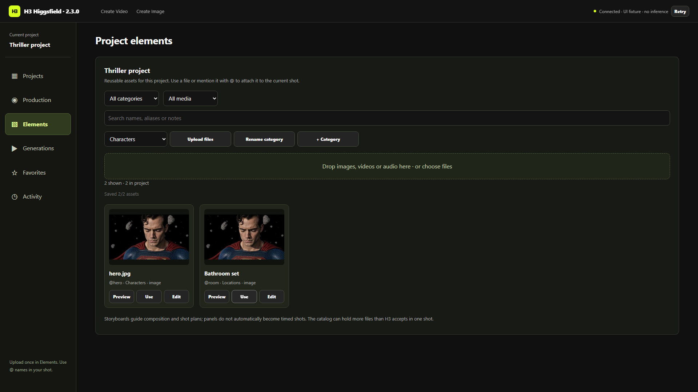
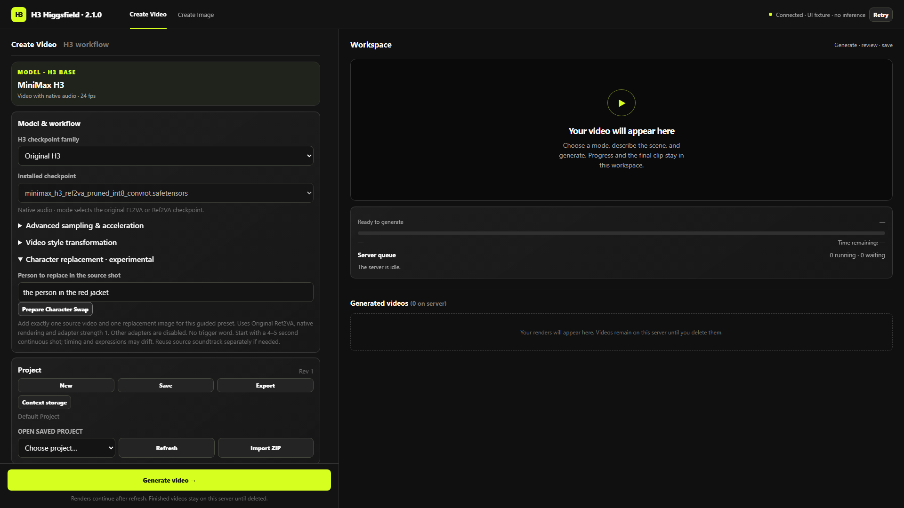
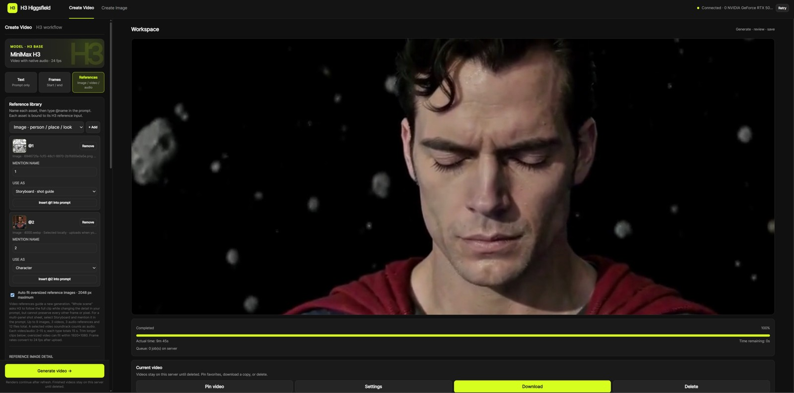

# H3 Higgsfield 2.5.2

### Direct the shot. Keep the whole workflow in view.

**MiniMax H3 video with native audio. Qwen image creation and editing. One browser workspace on your own machine or GPU server.**

[Get started](docs/INSTALL.md) · [Try the Superman example](docs/demo/superman/README.md) · [Features](#built-around-the-way-you-create) · [Community](https://github.com/underworldhistory1-ctrl/minimax-h3-higgsfield/discussions)

Generate at **Native detail · 1344×768** as the recommended upper baseline. Larger direct-generation canvases are experimental and can change the shot. **Upscale same take** enlarges a finished video and copies its audio without regenerating it. [Resolution and shot consistency](docs/RESOLUTION_AND_SAME_TAKE_AR.md).

**Storyboard direction + character appearance → a cinematic shot.** [Watch with audio](docs/demo/superman/superman-excerpt.mp4), then [open the references, setup and full prompt](docs/demo/superman/README.md).

## New in 2.5.2

- **Dedicated Anime → Realism:** the launcher now installs LiseTY’s pinned 310 MB Ref2VA adapter, previously missing. Video style transformation → Prepare selects it, inserts `LumiReal`, retains additional character/style references, and preserves your sampling overrides. Frontend and server enforce Original Ref2VA plus a source video. The reverse direction remains explicitly prompt-guided. [Compatibility, evidence and rollback](docs/ANIME_TO_REALISM_AR.md).

## New in 2.5.1

- **Refresh-safe work per tab:** unsaved references and settings survive refresh independently, including copied tabs and image BF16 settings. Clear a tab’s setup explicitly; failed storage never silently overwrites a recoverable snapshot. [Behavior and browser evidence](docs/TAB_PERSISTENCE_AR.md).

- **Native audio enhancement:** an optional extra audio pass preserves the exact final video latent, including after image refinement. Published AudioRefine evidence supports its Original H3 mechanism; it does not establish improved quality for every model, adapter or prompt.
- **One saved setup:** audio controls persist in projects, drafts and Reuse, appear in take settings, and have their own progress label and timing signature. Source soundtrack reuse bypasses the pass; continuation protects its existing audio prefix.
- **No new models or caching:** the pass uses the selected shifted model and LoRAs without MotionCache, Spectrum or structural patches. Existing renders and presets keep their behavior. The launcher ships the local nodes, license and official-upgrade fingerprints.

[Audio evidence, controls, compatibility, screenshots and rollback](docs/AUDIO_ENHANCEMENT_AR.md). No new GPU quality test was performed in this release.

## New in 2.4.0

- **Organized projects:** visible naming inside Production, project folders, Unfiled migration, scoped search and sorting. New projects use the selected folder.
- **Asset folders and transfers:** folders independent of reference roles, multi-selection, copy/move between projects with revision checks, dependency protection and interrupted-operation recovery. Stable reference IDs and source takes survive transfers.
- **Reuse every recorded take:** a visible card action restores the saved prompt, settings, references, LoRAs and advanced inputs into the chosen project's Production workspace. Missing inputs stay visible and block generation after Save/reload; using a changed setup requires explicit acknowledgement. Older videos without recorded inputs cannot claim full restoration.
- **Portable projects:** exported ZIPs use the project name and include unused catalog materials. The launcher includes all new runtime files and recognizes official 2.4.0 files for upgrades.

[Organization, Reuse, screenshots, tests and rollback](docs/ORGANIZATION_AND_REUSE_AR.md). Previous seed and short-duration fixes remain supported: [behavior and limits](docs/SEED_AND_DURATION_AR.md).

## Workspace improvements

- **Separate workspaces:** persistent navigation for Projects, Production, Elements, Generations, Favorites and Activity. Upload once in the full-page Elements library; filter, preview and reuse assets without crowding generation settings. Drag-and-drop and cached image thumbnails reduce unnecessary media loading.

- **Operation-aware updates:** audio/video exports, prompt/source/control preparation and quality checks block installation even when the ComfyUI render queue is empty. Other browsers can see those shared operation states.

- **Projects first:** create, name and open a production project. Its reusable catalog includes Characters, Locations, Props, Style, Audio, Storyboards, Custom and additional named categories. Multi-file uploads, editable names, notes and @ suggestions use the existing native reference compiler. Display-name edits preserve stable prompt aliases.
- **Project isolation:** the default gallery shows the project's takes. Older unassigned videos remain accessible under All server videos. Exported project bundles retain unused catalog assets, and durable job ownership recovers completed project takes after the initiating browser closes.
- **Shared export progress:** CPU upscale jobs are owned by the server. Every connected browser sees queue, encoding frames, verification, failures and completed downloads after refresh. Closing the initiating tab does not cancel the job. Launcher installation waits for both renders and exports to finish.

[Project workspace and shared exports](docs/PROJECT_WORKSPACE_AR.md).

- **Video library actions:** every generated video has visible Reuse, Options and Delete buttons. Options opens per-video enlargement, transfer of project takes, download, playback and settings; pinned deletion requires explicit confirmation.

- **Explicit attention baseline:** launcher paths use PyTorch dense attention. The actual server backend is visible and saved with each render; estimates separate different backends. Checkpoints can retain their native per-layer kernels.

- **Preserve an approved shot:** CPU Lanczos enlargement from the existing video, verified frame count, timing and copied audio. Generation resolution and generative refinement are clearly separate.

- **Live-server fixes:** static-image ControlNet sources, Arabic contextual guidance, correct final-video selection, restored Automatic preparation, and checkpoint labels that match the actual mode. [Server verification and limits](docs/SERVER_VERIFICATION_2026_10_13_AR.md).

- **Shared settings:** checkpoint, sampler, scheduler, shifts, precision, refinement and supported acceleration widgets stay synchronized with the submitted graph. Valid user overrides and project presets remain available.
- **Model choices:** Original H3, independent Singularity, FL2VA reference conditioning and a separate tensor-overlay Hybrid loader. Availability depends on installed models and required nodes.
- **References + structural control:** supported Fun ControlNet controls also work in References when ComfyUI includes the required PR #16020 implementation.
- **Character Swap:** a source-video + replacement-image preset on Original Ref2VA, strength 1 and pinned verified weights. No Turbo or training assistant dependency. [Usage and limits](docs/CHARACTER_SWAP_AR.md).
- **Video style direction:** separate Anime → realism and Realism → anime preparation, with separately selected installed style LoRAs and optional source soundtrack reuse. Automatic shot segmentation is not included.
- **Updated workspace:** wider resizable sidebar, larger type, compact previews, multi-image upload, editable aliases and ordered reference roles.
- **Automatic maintenance:** the launcher fast-forwards official `main` to the latest project source before installation, waits for an idle queue, preserves local edits and records rollback. Runtime dependencies remain pinned; assets are verified and reused. `--no-update` disables fetching; `--update-policy notify` only reports new versions.

**Validation:** Version 2.4.0 checks are recorded in [verified behavior](docs/VERIFIED_BEHAVIOR.md) and [project workspace](docs/PROJECT_WORKSPACE_AR.md); historical 2.1.1 checks included 289 Python tests and 139 JavaScript tests. [Current release checks](docs/VERIFIED_BEHAVIOR.md) distinguish code tests from historical GPU renders. Live RTX 5090 verification covers Original Ref2VA with an image reference and static-image Canny ControlNet: 124 frames, 864×480, 24fps and AAC audio. Singularity is installed, but independent Singularity, Hybrid and Character Swap GPU renders remain unverified.

## Your scene, with every reference given a job

Start with an idea, an opening frame, or a set of references. Tell Studio what each asset should contribute: the character, the location, the visual style, the camera movement, or the storyboard. Name it, mention it in the prompt, and inspect the result before rendering.

The workspace brings generation, reference handling, progress, projects and finished takes together. ComfyUI powers the work behind the page; the everyday creation flow stays in the studio.

*Production capture from the Superman example. Historical production example; version 2.1.1 adds the capabilities described below.*

## Built around the way you create

| What you want to do | What Studio gives you |
| --- | --- |
| **Direct from references** | Named images, videos and audio, clear reference roles, blue mentions and a preview of the connected tags. |
| **Bring a storyboard to life** | A dedicated **Storyboard · shot guide** role, paired with separate character references and your shot instructions. |
| **Write naturally** | Automatic formatting, Arabic/English headings, Markdown, JSON with comments and multiline YAML. Your original brief stays editable. |
| **Prepare a complex brief with AI** | Optional reference-aware preparation with a configured model, sampled video frames, validation and a preview. |
| **Shape motion or structure** | Optional Fun-ControlNet 2.0: extract body-motion, depth, outline or lighting guidance from an ordinary video when its models are installed. |
| **Refine a take** | Optional latent Refine and installed LoRAs, with availability checked before submission. |
| **Keep work across sessions** | Saved projects, portable export, continuation, temporal guides and finished takes with their settings. |
| **Share a GPU server** | A queue that separates your work from other projects and keeps cancellation scoped to your job. |
| **Create supporting images** | A separate Qwen Image 2.1 workspace for creation and reference-based editing. |

Start with **Original quality**. Try the available render methods and LoRAs when you want a different tradeoff; Studio shows what is installed on your server.

## Try it: Superman above Earth

| `@1` — Storyboard | `@2` — Character |
| --- | --- |
|  |  |
| Choose **Storyboard · shot guide** for the camera journey and reveal order. | Choose **Character** for the face, hair, physique and suit. |

1. Choose **Create Video → References**.
2. Upload the storyboard, name it **1**, and select **Storyboard · shot guide**.
3. Upload the character image, name it **2**, and select **Character**.
4. Paste the [creator’s prompt](docs/demo/superman/prompt.txt), inspect the preview, choose your output settings and generate.

The example includes the supplied reference images, production screenshot, prompt and a **4.21-second video excerpt**. [Open the complete walkthrough →](docs/demo/superman/README.md)

## A different fit for your workflow

H3 Higgsfield focuses on a dedicated browser workspace: reference roles, project continuity, a shared-server queue, selectable rendering options, and a combined video/image creation flow.

| If your priority is… | A useful starting point |
| --- | --- |
| **Creating and reviewing shots in a dedicated studio page** | **H3 Higgsfield**, with ComfyUI running behind the workspace. |
| **Building or changing the graph yourself** | [ComfyUI’s native H3 workflows](https://github.com/Comfy-Org/docs/blob/main/tutorials/video/minimax/minimax-h3-native.mdx). |
| **Adding multimodal prompt writing to an existing ComfyUI workflow** | [MiniMax H3 Prompt Writer](https://github.com/duckyshell/ComfyUI-MiniMaxH3-Prompt-Writer). |
| **Working inside a ComfyUI sidebar with a built-in clip editor** | [ComfyUI MiniMaxH3 Studio](https://github.com/rookiestar28/ComfyUI-MiniMaxH3-Studio). |

These are workflow choices, not a render-quality ranking. H3 Higgsfield is an independent project built on MiniMax H3 and ComfyUI, with no affiliation to Higgsfield or MiniMax. Its optional prompt preparation is separate from MiniMax’s hosted H3-Context-IR.

## Get started

Version **2.1.1** adds shared model/workflow settings, independent Singularity and distinct Hybrid profiles, References + ControlNet readiness checks, Character Swap, compact multi-image references and a resizable desktop sidebar. Turbo is retired. See the [compatibility/deployment guide](docs/MODERNIZATION_2026_10_13_AR.md) and [Character Swap guide](docs/CHARACTER_SWAP_AR.md). New configurations have code/browser coverage; GPU rendering acceptance remains pending.

**Windows or NVIDIA Linux:** follow the [installation guide](docs/INSTALL.md). It covers existing ComfyUI installations, first-time setup and verified model reuse. Once installed, open the studio page at your ComfyUI server address.

| Where you work | Guide |
| --- | --- |
| Windows or Linux | [Install the studio](docs/INSTALL.md) |
| One-command setup, attached storage and recovery | [Automatic launcher](docs/LAUNCHER.md) |
| Existing OpenBayes workspace | [Setup and recovery](docs/OPENBAYES.md) |
| SaladCloud | [Container deployment](deploy/SALAD_DEPLOYMENT.md) |
| Upgrading an existing V2 project | [Upgrade and rollback](docs/V2_UPGRADE_AR.md) |
| Restore the ComfyUI home page or remove Studio | [Uninstall safely](docs/UNINSTALL.md) |

The code is open source. You provide the GPU environment and download the model weights; cloud GPU and optional AI-provider costs depend on your setup.

## More renders to explore

Two comedy-club renders with the same scene and dialogue, using different acceleration methods. Each published demo is 15 seconds, 1280×704, 24 fps and 20 steps, with native audio and no LoRAs.

| Spectrum | MotionCache |
| --- | --- |
|  |  |
| [Watch with audio](docs/demo/spectrum-no-lora.mp4) | [Watch with audio](docs/demo/motioncache-no-lora.mp4) |

## A few things worth knowing

- **Automatic preparation is honest about what runs.** Without a configured AI provider, it formats your prompt locally. With one configured, it can prepare the brief with reference evidence. See [supported prompt formats](docs/PROMPT_INPUT.md).
- **Optional controls need their models.** Refine, ControlNet, motion/depth extractors and LoRAs appear according to readiness. Their presence is not a guarantee of a better take.
- **References guide a new generation.** Storyboards and source videos influence the result; they do not lock every pixel, camera move or cut.
- **Hardware matters.** Models require substantial disk space, and longer high-resolution clips need enough system RAM as well as VRAM. [Installation requirements](docs/INSTALL.md) and [verified behavior](docs/VERIFIED_BEHAVIOR.md) keep the details together.
- **Check model licenses for your use.** Qwen Image 2.1 uses the Qwen Research License. Repository code, demo media, model weights and third-party components have separate licenses.

## Make something, then share it

Post a shot, a reference experiment or a setup question in [Discussions](https://github.com/underworldhistory1-ctrl/minimax-h3-higgsfield/discussions). For a reproducible problem, open an [Issue](https://github.com/underworldhistory1-ctrl/minimax-h3-higgsfield/issues).

[Connected Studio guide](docs/CONNECTED_STUDIO.md) · [Verified behavior](docs/VERIFIED_BEHAVIOR.md) · [Prompt formats](docs/PROMPT_INPUT.md) · [Graph map](docs/GRAPH_MAP.md)

Built on [MiniMax H3](https://huggingface.co/MiniMaxAI/MiniMax-H3) and [ComfyUI](https://github.com/Comfy-Org/ComfyUI). Code: [MIT](LICENSE).

### 2.3.0 — separate production workspaces

Persistent navigation separates Projects, Production, Elements, Generations, Favorites and Activity. Project assets have a full-page searchable library, category/media filters, multi-upload and drag-and-drop, editable names/categories/notes and on-demand previews. `Use` keeps stable reference aliases and returns to Production. Cached 320×240 image thumbnails leave original conditioning assets untouched. Shared CPU export/preparation operations also block unsafe launcher restarts. See [the workspace guide](docs/PROJECT_WORKSPACE_AR.md) for behavior and evidence boundaries.
