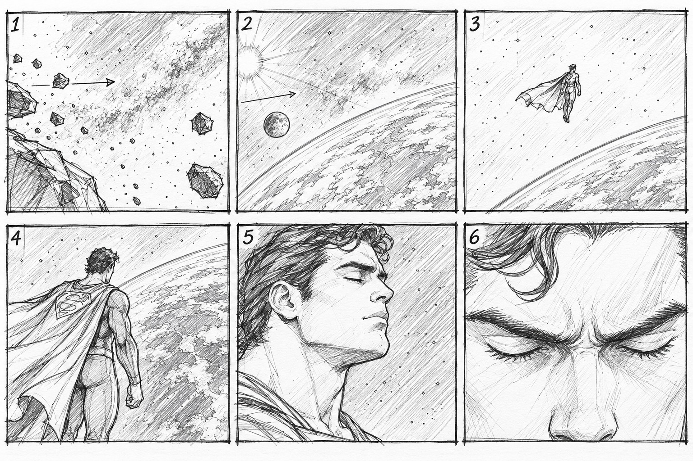

# H3 Higgsfield

**Current release: 2.6.0 · verified installation and adapter readiness**

### Start a scene directly

Production opens immediately, with no manual project requirement. **Save scene** or **Generate** creates its own named workspace when needed. **New scene** saves the previous working setup before opening clean defaults. Use the top **Save scene to** picker to copy the current setup into a new scene/shot in an existing project; existing scenes and takes remain intact. Choosing Automatic detaches the current setup for independent saving. Continuation sources must be cleared before switching ownership between projects.

Opening the plain Studio link starts with an empty setup, including when a browser copies another tab's session storage. Each new page gets its own render identity, so separate pages can submit independent jobs to the server queue. Refreshing the same tab keeps its inputs, project and render tracking. Click the H3 logo to refresh that tab. Explicit project, Reuse and job links still open the requested saved work; the last project is never selected implicitly from shared browser storage.

**Clear setup**, inside More scene tools, resets the working inputs/settings and checkpoints the reset on this device. It preserves saved project setups and output files. Project management and advanced scene/shot tools are collapsed until needed. **Download** is available directly on video and image cards. Generations search matches all entered words across recorded prompts, filenames and settings within the chosen library scope.

[Scene workspace verification](docs/SCENE_WORKSPACE_2026_10_29.md) records tests and limits.

[2.6 release verification](docs/RELEASE_2_6.md) records code, installation and current-server GPU test boundaries.

### Updates and ComfyUI

The shared video/image header opens the ComfyUI node editor in a separate tab. Updates shows a numbered badge when a new official revision is available and checks again while Studio is in use. Checks compare official source, installed interface/backend files and the code observed by the running worker. An incomplete copy or missing restart reports installation attention; a failed check cannot keep an older up-to-date claim. This checks Studio code; model/LoRA files are separate prerequisites. The update sheet preserves generation and recovery guards; installation still requires an idle queue and a manual ComfyUI restart.

[Community request review](docs/COMMUNITY_REVIEW_2026_10_29.md) records existing features, implemented improvements and options that still need validation.

### Project elements and image replacement

A collapsed image Reference card has **Replace** beside Remove. It changes that shot's image while keeping the mention name, role and position. Save scene to retain this shot change on the server. **Replace image** in Elements replaces the reusable element and its editable saved shot bindings, retaining its display name, identifier, category and notes. Historical takes keep their original image; those archived originals remain in project exports and can still be reused or copied.

Corrupt images and failed uploads retain the original. Revision checks reject stale edits; a lost replacement response is reconciled by reading the exact saved operation, without resubmitting it. Project creation requests also retain one identity across retries in the active tab. Catalog names and shot mention names remain separate; case collisions and ambiguous display mentions cannot silently choose another reference. Large element libraries render 60 items at a time while search covers all elements.

[Project and Elements verification](docs/PROJECT_ELEMENTS_PLAN_2026_10_29.md) records the failure cases and test boundaries.

### Reference names and native tags

Reference chips show each attached image's `Picture` number and its related `Subject` number. Pictures follow image card order; Subject numbers can differ and follow explicit `subject_definitions` when supplied. For example, `<Subject 1> is the man from @2` automatically links to the actual image named `@2`; the alias does not imply Picture2. Native tags also work in ordinary guided prose, without repeating aliases. Common explicit forms such as `<subject1>` normalize automatically. A conflicting explicit Picture and alias reports the actual mapping instead of silently changing identity.

The **Mention name** on a reference card belongs to that shot. Rename the shared project element separately in **Elements**. Opening the current project keeps the working setup; project links retain the selected page on refresh. Navigation checkpoints the local setup first and avoids rewriting an unchanged server draft. Restoring references loads independent inputs together and reuses recently downloaded originals within a bounded browser cache; failed downloads remain visible and retryable.

Projects remain browsable during generation. **Open** uses a separate tab while rendering or loading, keeping the running tab and its inputs intact; when idle, it opens in the current tab. Ctrl/Cmd-click also opens a separate tab.

### H3 and LTX on one Linux GPU

With the matching LTX `studio_shared_gpu` custom node installed, set `STUDIO_SHARED_GPU_LOCK` to the same absolute lease path in both workers. Set `STUDIO_SHARED_GPU_PEER=http://127.0.0.1:8189` for H3 and `http://127.0.0.1:8188` for LTX, then restart each worker only when idle. The guard reserves the GPU before native queue admission, so waiting H3/Qwen and LTX prompts stay pending and cancellable instead of allocating together. It releases the lease after execution or process exit, checks peer readiness and CUDA memory, and can unload an idle peer's GPU model cache while retaining RAM caches. Without these environment variables the guard is inactive. This coordinates native ComfyUI prompt execution, rather than promising one global FIFO across the two Studio interfaces.

## Reuse a saved take

Click **Reuse** to reload directly into Production using a link to the selected output. The saved prompt, references, adapter strengths and render settings are copied into an independent workspace inside the original project's automatic **Reuse** folder. Reuse of a reused result stays with that same original project, including after renaming it. The library groups these setups under a folder card and an original-project **Reuse (count)** shortcut; searching also finds individual setups. A request retry reopens the same workspace without overwriting subsequent edits. The final URL identifies the restored project and survives refresh. The source take and any backend render remain intact. Missing original files are reported in Production; Reuse does not invent missing inputs or start generation automatically.

**New project** in Production and **Create project** in the library share one creation flow: save the current setup, then start with clean defaults. **Save scene** uses the guarded workspace save, and **More scene tools → Export project ZIP** saves the latest setup before downloading. A scene with no shot retains its local editor checkpoint when leaving; explicit Save/Export asks you to create or select a shot first.

## Direct the shot. Keep the whole workflow in view.

**MiniMax H3 video with native audio. Qwen image creation and editing. One browser workspace on your own machine or GPU server.**

[Get started](docs/INSTALL.md) · [Try the Superman example](docs/demo/superman/README.md) · [Features](#built-around-the-way-you-create) · [Community](https://github.com/underworldhistory1-ctrl/minimax-h3-higgsfield/discussions)

Generate at **Native detail · 1344×768** as the recommended upper baseline. Larger direct-generation canvases are experimental and can change the shot. **Upscale same take** enlarges a finished video and copies its audio without regenerating it. [Resolution and shot consistency](docs/RESOLUTION_AND_SAME_TAKE_AR.md).

**Storyboard direction + character appearance → a cinematic shot.** [Watch with audio](docs/demo/superman/superman-excerpt.mp4), then [open the references, setup and full prompt](docs/demo/superman/README.md).

## Current release

- CUDA 13 native acceleration is checked on the actual running worker. Optional Comfy Kitchen INT8 attention is selected explicitly and verified after startup.
- Linux workers restart under supervision. Completed sampler latents are saved before decode; supported decode recovery is tracked and preserves cancellation.

- Project Elements use stable asset identities, named mentions and immediate reference attachment. Display names and legacy aliases are reconciled before native tag compilation.
- Video, audio, image, keyframe and control uploads share validated backend handling. Qwen references and working setups persist per tab, including provider proxy URLs. Installation refreshes compressed interface assets to prevent stale pages.
- English is the default for workflow explanations; Help language switches those explanations to Arabic.
- Studio checks official source updates and exposes safe installation status. Updates preserve user data and require idle generation and preparation work; see [update behavior](docs/LAUNCHER.md).
- [Changelog](CHANGELOG.md) records release history. [Current audit](docs/PRODUCTION_READINESS_2026_10_15.md) records 452 Python tests, 170 JavaScript tests, real browser/API checks and completed Original and Singularity video/audio renders.

## Built around the way you create

| What you want to do | What Studio gives you |
| --- | --- |
| **Direct from references** | Named images, videos and audio, clear reference roles, blue mentions and a preview of the connected tags. |
| **Bring a storyboard to life** | A dedicated **Storyboard · shot guide** role, paired with separate character references and your shot instructions. |
| **Write naturally** | Automatic formatting, Arabic/English headings, Markdown, JSON with comments and multiline YAML. Your original brief stays editable. |
| **Prepare a complex brief with AI** | Optional reference-aware preparation with a configured model, sampled video frames, validation and a preview. |
| **Shape motion or structure** | Optional Fun-ControlNet 2.0: extract body-motion, depth, outline or lighting guidance from an ordinary video when its models are installed. |
| **Refine a take** | Optional latent Refine and installed LoRAs, with availability checked before submission. |
| **Keep work across sessions** | Saved projects, portable export, continuation, temporal guides and finished takes with their settings. |
| **Share a GPU server** | A queue that separates your work from other projects and keeps cancellation scoped to your job. |
| **Create supporting images** | A separate Qwen Image 2.1 workspace for creation and reference-based editing. |

Start with **Original quality**. Try the available render methods and LoRAs when you want a different tradeoff; Studio shows what is installed on your server.

## Optional Turbo v4 EMA

Turbo v4 EMA is available for Original Text/Frames at 4–8 steps (6 initial), using the current upstream loader and adaptive audio/video sampler. References has a separate LightX2V Ref2VA 8-step v1.0 option, tested on this server with a complete video/audio output. Install these explicitly; other adapters and extra passes are unsupported. [Installation and scope](docs/TURBO_V4.md).

## Models and acceleration

| Name | What it selects |
| --- | --- |
| **Original quality** | MiniMax H3 INT8 ConvRot: FL2VA for Text/Frames, Ref2VA for References. |
| **Singularity v1.3 INT8** | An optional independent Ref2VA checkpoint; a complete render with Anime → Realism passed video/audio decoding. |
| **Hybrid conditioning / Hybrid loader** | Two distinct experimental paths; complete GPU output quality remains unverified. |
| **Qwen Image 2.1** | Separate image creation/editing workspace; INT8 is installed by default, BF16 is optional. |
| **PyTorch / CK INT8 attention** | Server attention choices, separate from model precision and the Spectrum/MotionCache render methods. |

A matched RTX 5090 Ref2VA test took **9m43 s with CK INT8 attention versus 20m01 s
with PyTorch Flash** at 1024×576,362 frames,20 steps,seed42 and identical references.
This measures one workload; quantized attention changes arithmetic and can change
the result. BF16/FP16 operations alongside INT8 weights are expected.
[Measured settings, verification and limits](docs/LAUNCHER.md#attention-selection-and-supervised-workers).

## Try it: Superman above Earth

| `@1` — Storyboard | `@2` — Character |
| --- | --- |
|  |  |
| Choose **Storyboard · shot guide** for the camera journey and reveal order. | Choose **Character** for the face, hair, physique and suit. |

1. Choose **Create Video → References**.
2. Upload the storyboard, name it **1**, and select **Storyboard · shot guide**.
3. Upload the character image, name it **2**, and select **Character**.
4. Paste the [creator’s prompt](docs/demo/superman/prompt.txt), inspect the preview, choose your output settings and generate.

The example includes the supplied reference images, production screenshot, prompt and a **4.21-second video excerpt**. [Open the complete walkthrough →](docs/demo/superman/README.md)

## A different fit for your workflow

H3 Higgsfield focuses on a dedicated browser workspace: reference roles, project continuity, a shared-server queue, selectable rendering options, and a combined video/image creation flow.

| If your priority is… | A useful starting point |
| --- | --- |
| **Creating and reviewing shots in a dedicated studio page** | **H3 Higgsfield**, with ComfyUI running behind the workspace. |
| **Building or changing the graph yourself** | [ComfyUI’s native H3 workflows](https://github.com/Comfy-Org/docs/blob/main/tutorials/video/minimax/minimax-h3-native.mdx). |
| **Adding multimodal prompt writing to an existing ComfyUI workflow** | [MiniMax H3 Prompt Writer](https://github.com/duckyshell/ComfyUI-MiniMaxH3-Prompt-Writer). |
| **Working inside a ComfyUI sidebar with a built-in clip editor** | [ComfyUI MiniMaxH3 Studio](https://github.com/rookiestar28/ComfyUI-MiniMaxH3-Studio). |

These are workflow choices, not a render-quality ranking. H3 Higgsfield is an independent project built on MiniMax H3 and ComfyUI, with no affiliation to Higgsfield or MiniMax. Its optional prompt preparation is separate from MiniMax’s hosted H3-Context-IR.

## Get started

**Windows or NVIDIA Linux:** follow the [installation guide](docs/INSTALL.md). It covers existing ComfyUI installations, first-time setup and verified model reuse. Once installed, open the studio page at your ComfyUI server address.

| Where you work | Guide |
| --- | --- |
| Windows or Linux | [Install the studio](docs/INSTALL.md) |
| One-command setup, attached storage and recovery | [Automatic launcher](docs/LAUNCHER.md) |
| Existing OpenBayes workspace | [Setup and recovery](docs/OPENBAYES.md) |
| SaladCloud legacy image | [Image status and deployment requirements](deploy/SALAD_DEPLOYMENT.md) |
| Upgrade or roll back an existing installation | [Upgrade and rollback](docs/V2_UPGRADE_AR.md) |
| Restore the ComfyUI home page or remove Studio | [Uninstall safely](docs/UNINSTALL.md) |

The code is open source. You provide the GPU environment and download the model weights; cloud GPU and optional AI-provider costs depend on your setup.

## More renders to explore

Two comedy-club renders with the same scene and dialogue, using different acceleration methods. Each published demo is 15 seconds, 1280×704, 24 fps and 20 steps, with native audio and no LoRAs.

| Spectrum | MotionCache |
| --- | --- |
|  |  |
| [Watch with audio](docs/demo/spectrum-no-lora.mp4) | [Watch with audio](docs/demo/motioncache-no-lora.mp4) |

## A few things worth knowing

- **Automatic preparation is honest about what runs.** Without a configured AI provider, it formats your prompt locally. With one configured, it can prepare the brief with reference evidence. See [supported prompt formats](docs/PROMPT_INPUT.md).
- **Optional controls need their models.** Refine, ControlNet, motion/depth extractors and LoRAs appear according to readiness. Their presence is not a guarantee of a better take.
- **References guide a new generation.** Storyboards and source videos influence the result; they do not lock every pixel, camera move or cut.
- **Hardware matters.** Models require substantial disk space, and longer high-resolution clips need enough system RAM as well as VRAM. [Installation requirements](docs/INSTALL.md) and [verified behavior](docs/VERIFIED_BEHAVIOR.md) keep the details together.
- **Check model licenses for your use.** Qwen Image 2.1 uses the Qwen Research License. Repository code, demo media, model weights and third-party components have separate licenses.

## Make something, then share it

Post a shot, a reference experiment or a setup question in [Discussions](https://github.com/underworldhistory1-ctrl/minimax-h3-higgsfield/discussions). For a reproducible problem, open an [Issue](https://github.com/underworldhistory1-ctrl/minimax-h3-higgsfield/issues).

[Connected Studio guide](docs/CONNECTED_STUDIO.md) · [Verified behavior](docs/VERIFIED_BEHAVIOR.md) · [Prompt formats](docs/PROMPT_INPUT.md) · [Graph map](docs/GRAPH_MAP.md)

Built on [MiniMax H3](https://huggingface.co/MiniMaxAI/MiniMax-H3) and [ComfyUI](https://github.com/Comfy-Org/ComfyUI). Code: [MIT](LICENSE).

### Optional Qwen Image 2.1 V2 LoRA

Create Image has a separate LoRA selector and strength (0–2, initial 0.8), defaulting to None. The TheseAlpacas V2 option is enabled only when its file is installed. Selection and strength survive refresh and are stored in image settings; the model-only adapter precedes reference caching in edit mode. Install explicitly with `python deploy/download_qwen_loras.py /path/to/ComfyUI`; add `--offline-check` to verify the pinned 79,744,352-byte file and SHA-256 without downloading. The download uses a pinned Hugging Face mirror revision. No LoRA is enabled automatically.
