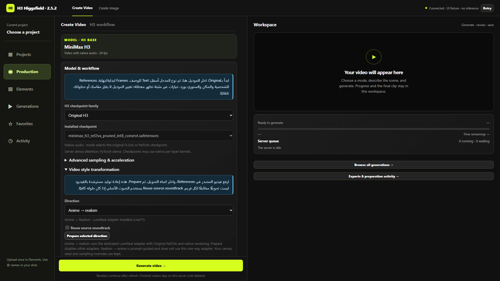

# Anime to Realism

LiseTY's independent Ref2VA adapter uses `LumiReal` to guide anime-video transformation. It differs from Realism People and Anime-Motion. The launcher prepares it; users enable it explicitly.

1. Upload a source video in References, plus optional named Character/Style images.
2. Open **Model & workflow → Video style transformation → Anime → realism → Prepare selected direction**.
3. The shortcut enables the adapter and writes source/LumiReal instructions. Compatible selected model, method, canvas, duration, seed and advanced settings remain under shared configuration rules. Existing strength is retained; 1 is a starting point, not a measured optimum.
4. Optionally select **Reuse source soundtrack**, with sufficient source duration.

The label is **Anime → Realism · LumiReal / Ref2VA**. The publisher's filename retains its original typo: `Anime2Realsim__H3.safetensors`.

| Weight | Pinned value |
| --- | --- |
| Publisher | [LiseTY](https://huggingface.co/LiseTY/Minimax-H3-ref2v_Anime_2_Realism) |
| Revision | `33ee6502c125eea847aac14c49fecca43737ee40` |
| Bytes | 310168760 |
| SHA-256 | `bce58949e0983115bb9b7f2cf79f7474119ce2cedd845e4c565666fabfde2a3e` |
| Metadata | minimax_h3_ref2va, 416 tensors, rank 32 |

Cached verified files are reused; no new package/node is required. A historical Singularity v1.3 INT8 strength-1 output completed at 209 frames, 1024×576 and 24 fps with full video/audio decode. This establishes that execution, not universal conversion quality. Hybrid quality remains unverified. Realism → Anime is prompt-only; Studio does not reverse this adapter with negative strength.

Frontend/backend tests cover inputs, filename, strength and connected model. Browser fixtures cover Prepare, reverse direction and missing files. Disable the adapter to remove its graph stage. [Launcher/rollback](LAUNCHER.md) · [GPU evidence](PRODUCTION_READINESS_2026_10_15.md).

