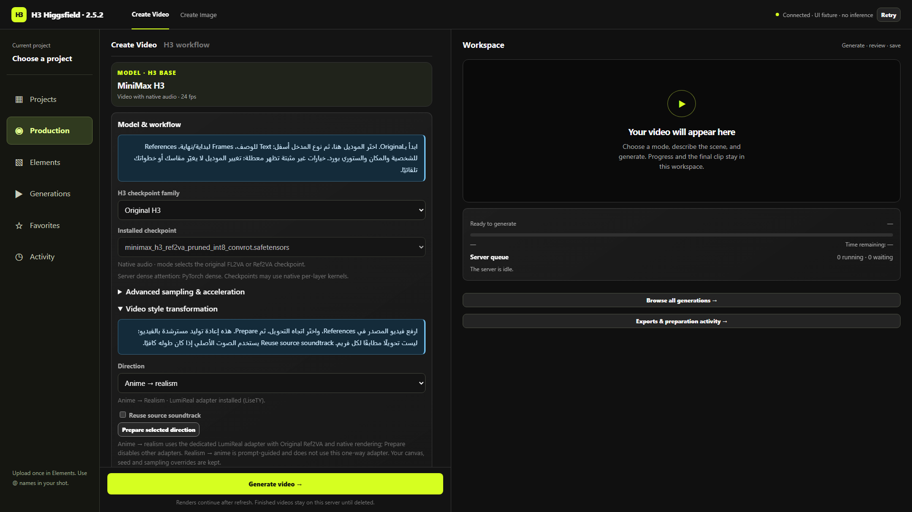

# Anime → Realism — إصلاح 2.5.2

المراجعة كشفت إن قائمة اللانشر كانت بتجهز Realism People لكنها أغفلت اللورا المخصصة لتحويل الأنمي. اختيار التحويل القديم كان قالب برومبت فقط. عبارة الجاهزية الكاملة كانت أوسع من الدليل.

## الاستخدام

1. من Production ارفع فيديو المصدر في References. ممكن تضيف صور Character وStyle بأسماء مستقلة.
2. افتح Model & workflow → Video style transformation → Anime → realism → Prepare selected direction.
3. القالب يحدد Original Ref2VA وNative ويشغل Anime → Realism وحدها، مع `LumiReal` وذكر كل المراجع الإضافية. المقاس والمدة والسيد وإعدادات العينة لا تتبدل. قوة اللورا الحالية تُحفظ؛ 1 نقطة بداية وليست قيمة مثالية مؤكدة.
4. اختيار Reuse source soundtrack منفصل. راجع أن مدة المصدر كافية.

اسمها المرئي في LoRAs هو **Anime → Realism · LumiReal / Ref2VA**. اسم الملف الأصلي فيه typo عند الناشر؛ نحافظ عليه: `Anime2Realsim__H3.safetensors`.

## تثبيت قابل للتحقق

- [مصدر الناشر](https://huggingface.co/LiseTY/Minimax-H3-ref2v_Anime_2_Realism).
- Revision: `33ee6502c125eea847aac14c49fecca43737ee40`.
- Size: `310168760` bytes.
- SHA-256: `bce58949e0983115bb9b7f2cf79f7474119ce2cedd845e4c565666fabfde2a3e`.
- Safetensors metadata: `ss_base_model_version=minimax_h3_ref2va`; 416 tensors، rank 32.
- يتجهز تلقائيًا مع اللانشر؛ الملف الصحيح الموجود يُعاد استخدامه دون تنزيل إضافي. لا توجد حزم Python أو نودز جديدة.

التحقق من الملف والجراف لا يضمن أداءً بصريًا لكل فيديو. FL2VA وSingularity وHybrid غير مثبتين لهذا adapter وتُرفض تركيباتهم. Realism → Anime قالب منفصل، ولا نعكس هذه اللورا بقوة سالبة. Realism People لورا مختلفة.

## التحقق والرجوع

اختبارات Frontend/backend تغطي الملف والقوة والموديل والربط الفعلي بالعينة، وتمنع تجاوز التوافق عبر طلب قديم. اختبار متصفح مع backend وهمي يغطي Prepare والاتجاه العكسي والملف الناقص والمراجع الإضافية والإعدادات المحفوظة. لا يمثل اختبار المتصفح رندر GPU أو دليل جودة التحويل.

للرجوع إلى 2.5.1 أوقف الخدمة بعد خلو الطابور، استعد runtime snapshot المسجل في `.h3-launcher` حسب [دليل اللانشر](LAUNCHER.md)، ثم شغل الخدمة. يحتفظ الملف الجديد بوجوده على القرص؛ لا يلزم حذفه ولا حذف المشاريع أو النتائج. تعطيل اللورا في الواجهة يعيد الجراف المعتاد دون إعادة تثبيت.

نتائج هذه النسخة: **355 Python + 152 JavaScript** ناجحين، واختبار متصفح التحويل واختبار Organization/Reuse ناجحين. على السيرفر الحالي تطابقت بصمة الملف والحجم، و208 موضع تعديل موجودين داخل checkpoint Ref2VA المثبت. لم يتم تشغيل رندر GPU جديد للتحويل في هذا الإصلاح.

