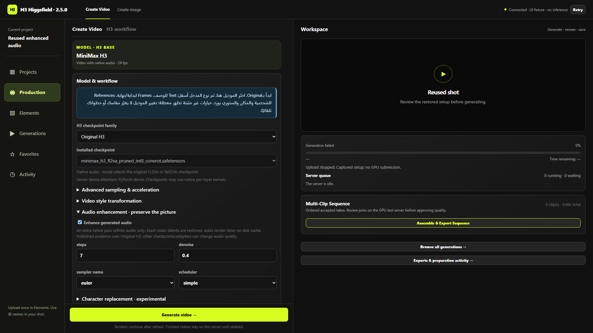

# Generated-audio enhancement

Enable **Model & workflow → Audio enhancement · preserve the picture → Enhance generated audio** for an additional native H3 pass after the last picture sample. Defaults: 6 steps, denoise 0.5, Euler/simple, CFG 1. Steps accept 1–20 and denoise 0.01–1. Higher values may change dialogue/effects and are not automatically better. Settings persist with projects, drafts, Reuse and timing metadata; existing projects do not enable it automatically.

The pass freezes picture sampling and restores the exact original video latent before decode. It uses the base Sigma/LoRA/Dials model path, bypassing picture acceleration and separate refinement LoRA strengths. Continuation protects previous audio context. Source soundtrack reuse bypasses enhancement. ControlNet combinations are currently rejected; Pika/Turbo disable extra passes. Missing nodes or incompatible saved settings block submission visibly.

This follows [AudioRefine's MIT mechanism](https://github.com/Adudeguyman/ComfyUI-H3-AudioRefine/tree/d78d34f2f1100b0422047e9d784a3bdb4e1061d3) with added picture/continuation protection. The publisher demonstrated Original H3 with a 4-step Turbo picture pass and 6 audio steps; that does not establish improvement for every model/adapter. This is not an existing-MP4 cleanup filter. Picture tokens remain attention context, so audio steps still cost substantial computation.

CPU tests check exact picture restoration, continuation protection and invalid-input rejection. Server tests check selected model/settings/seed/path. Browser tests cover controls, Save/reload, Reuse, Generate capture, uint64 rollover, source-audio bypass and mobile layout. These are not new GPU audio-quality evidence.

[Browser evidence](audio/audio-browser-verification.json) · [Compatibility](COMPATIBILITY_MATRIX.md).
