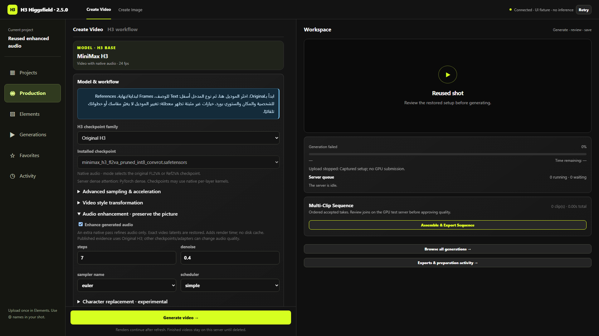

# تحسين صوت H3 — إصدار 2.5.0

أضفنا مرحلة صوت إضافية من نفس H3، بعد انتهاء توليد الصورة وأي image refinement. المرحلة تثبّت الصورة أثناء العينة، وترجع لاتنت الفيديو الأصلي حرفيًا قبل فك الصورة والصوت. دي إعادة تحسين للصوت المولّد؛ مش فلتر لتنظيف ملف MP4 قديم، ومش موديل صوت جديد.

## الدليل المنشور

صاحب [AudioRefine](https://github.com/Adudeguyman/ComfyUI-H3-AudioRefine/tree/d78d34f2f1100b0422047e9d784a3bdb4e1061d3) نشر مثالًا وقياسات تشغيل على Original H3: توليد Turbo من 4 خطوات يتبعه 6 خطوات للصوت على فرع الموديل قبل Turbo، بدقة 1376×768 ولمدة 10 ثوانٍ. المثال يثبت تشغيل المسار في إعداداته؛ لا يثبت تحسينًا مضمونًا لكل native 20-step أو Singularity أو Hybrid أو LoRA. المؤلف نفسه بيوصف المشروع بالتجريبي؛ مفيش دليل يسمح لنا نسمي تحسن الجودة مضمونًا عبر كل التركيبات.

استخدمنا آلية الماسك الأصلية بدون كاش تقريبي، مع حفظ ترخيص MIT. أضفنا حماية نهائية للصورة وصوت التكملة. لم نُعِد Turbo أو نضيف ملفات موديل. خطوات الصوت ما زالت تكلف تقريبًا تمريرة الموديل كاملة لأن الصورة تظل سياقًا للانتباه.

إصلاحات ComfyUI الرسمية لـ[توقيت الصوت](https://github.com/Comfy-Org/ComfyUI/pull/15243)، [EasyCache](https://github.com/Comfy-Org/ComfyUI/pull/15390)، و[special tokens](https://github.com/Comfy-Org/ComfyUI/pull/15808) موجودة بالفعل في النسخة المثبتة `3b4c0b0e457cf0a51cf3038e0a6750d8f96ce251`. لم نركّب [PR16750](https://github.com/Comfy-Org/ComfyUI/pull/16750) أو [PR16957](https://github.com/Comfy-Org/ComfyUI/pull/16957) غير المدموجين، ولم نغيّر AudioVAE الأصلي fp32. حالة المصادر دي اتراجعت في 14 أكتوبر 2026.

مجموعة [smhfacct Hybrid](https://huggingface.co/smhfacct/Minimax-H3-fl2va-ref2va-hybrid-models) checkpoints مدموجة تجريبيًا؛ ليست ترقية رسمية للصوت أو نفس tensor overlay الموجود عندنا. لم تُنزّل أو تُثبّت ضمن التحديث.

## الاستخدام

داخل Production، افتح Model & workflow → Audio enhancement · preserve the picture، وفعّل Enhance generated audio. الافتراضي 6 خطوات، denoise 0.5، Euler/Simple، وCFG 1. الخطوات متاحة من 1 إلى 20، وdenoise من 0.01 إلى 1، مع sampler وscheduler ضمن المتاح على السيرفر. القيمة الأعلى قد تغيّر الكلام والمؤثرات؛ لا تعني جودة أعلى تلقائيًا.

الاختيار محفوظ في المشروع والـdraft وReuse، ولا نفعّله تلقائيًا في مشاريعك القديمة. حفظه مرة في مشروع يخليه يرجع مع المشروع. يظهر في Settings للفيديو، وتقدير الوقت يميز إعداداته، والتقدم يعرض Audio enhancement. لو النودز غير متاحة، الخيار يظهر معطلًا ويطلب تحديث Runtime؛ السيرفر يرفض الجراف غير المطابق للإعدادات.

## التوافق

| الحالة | السلوك والدليل |
|---|---|
| Original Text / Frames / References | مرحلة بعد آخر عينة صورة؛ مبنية على المصدر ومثال المؤلف، والتوصيل مختبر محليًا |
| Singularity / Hybrid conditioning / Hybrid loader | التوصيل مختبر؛ لا يوجد قياس GPU لجودة الصوت هنا أو أفضلية مضمونة |
| Native / MotionCache / Spectrum | مرحلة الصوت تستخدم node 2 مع shift والـLoRAs؛ تتجاوز كاش وpatch تسريع الصورة |
| Image refinement | الصوت يحصل على ناتج عينة الصورة الأخيرة؛ السيرفر يرفض تجاوزها |
| Fun ControlNet | الصورة تحت التحكم؛ الصوت على فرع الموديل قبل patch التحكم. الجودة مع ControlNet لم تُختبر على GPU |
| LoRAs ومنها Character Swap | سلسلة LoRAs التوليد نفسها، بقوتها الأصلية؛ لا تتبدل لقوة مرحلة refinement. التوصيل الصحيح ليس دليل جودة لكل LoRA |
| Continuation | ماسك وحماية نهائية لصوت الجزء السابق، وتحسين الجزء الجديد فقط |
| Reuse source soundtrack | تجاوز مرحلة التحسين مع بقاء الصوت الأصلي والمسار الموجود |
| Native audio references | تظل في conditioning؛ لا ندّعي تطابقًا أو تحسنًا دائمًا لصوت المرجع |
| Upscale same take / MP4 قديم | ليست مرحلة تحسين صوت ملف موجود؛ الـupscale يحتفظ بصوته |

## الاختبارات

- نجح 353 اختبار Python و151 اختبار JavaScript، منهم 72 جراف: 3 أنواع مدخل × 4 اختيارات موديل × 3 طرق rendering × تفعيل/إيقاف image refinement.
- اختبارات Torch على CPU تثبت تطابق الفيديو الأصلي حرفيًا حتى مع حقن انحراف في عينة الصوت، وحماية صوت الجزء السابق. تغيّر الأبعاد والقيم غير finite مرفوضان.
- اختبارات قبول السيرفر ترفض settings أو seed أو model أو links خاطئة، وتجاوز آخر عينة صورة، وتشغيل المرحلة عند عدم جاهزيتها.
- Playwright مع API مشاريع حقيقي محليًا أثبت التشغيل، وتغيير الإعدادات، وSave/reload، وReuse، والتقاط Generate الفعلي، وuint64 rollover، وتجاوز المرحلة عند الاحتفاظ بصوت المرجع، وعدم overflow بعرض 390px. اختبار تنظيم المشاريع ونقل المواد وReuse السابق عدّى أيضًا.
- لم تُرسل أي عينة GPU ولم نقِس تحسن صوت فيلم فعلي في النسخة دي. غلاف NestedTensor في اختبار CPU بديل صغير؛ ليس اختبار Native Comfy KSampler كاملًا.

[دليل المتصفح](audio/audio-browser-verification.json).

## التحديث والرجوع

اللانشر بسياسة التحديث الحالية ينزّل main الرسمية قبل بدء الخدمات، ويحافظ على البيانات والتعديلات المحلية. النودز الجديدة والترخيص داخل runtime manifest، وبصمات 2.4.0 مضافة لترقية الملفات الرسمية. أوقف الوظائف النشطة واعمل backup قبل تحديث مهم؛ عمليات التثبيت لا تتم أثناء الرندر.

إيقاف Enhance generated audio يرجع لجراف الصوت السابق. للرجوع للكود الكامل استخدم rollback المسجل باللانشر، أو tag `v2.4.0` مع `--no-update`. لا تحذف بيانات المشاريع؛ الإعداد الجديد إضافة ولا ينقل ملفاتك. هذا التحديث على الريبو وحزمة التوزيع فقط، ولم يتصل بسيرفر GPU.

