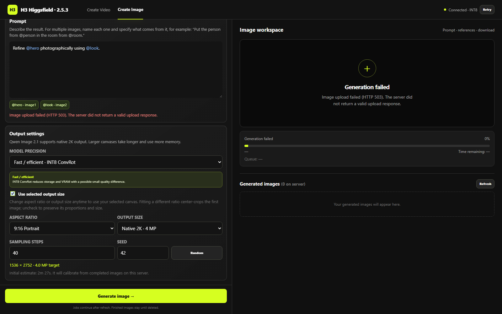

# Image uploads and canvas behavior

Image uploads use bounded JSON/base64 because some public gateways reject multipart before ComfyUI. The backend checks request size, the 25 MB file limit and actual PIL image content. Multipart remains supported. Failure/cancellation preserves existing inputs and cleans up readers/listeners.

Canvas controls stay available after uploading. Changing size/ratio enables **Use selected output size**. Disabling it follows the first reference's dimensions. Encoder resolution 0 keeps the first image aligned with output sizing; native additional-reference scaling is separate. A different ratio center-crops the first image; it is not outpainting.

Files use IndexedDB and settings/names use the tab draft. Refresh restores that tab; a fresh plain page is independent. Clear does not delete server media. Windows LoRA matching accepts separators while submitting actual backend spelling. Clear resets the adapter/strength. Canvas predictions follow integer thumbnail scaling and ties-to-even grid rounding; metadata uses actual PNG dimensions.

Tests cover uploaded bytes, corrupt-file rejection, failure preservation, graph scaling, persistence, isolation and rounding. Browser checks are not Qwen visual-quality evidence. [Installation](INSTALL.md) · [Rollback](V2_UPGRADE.md).

