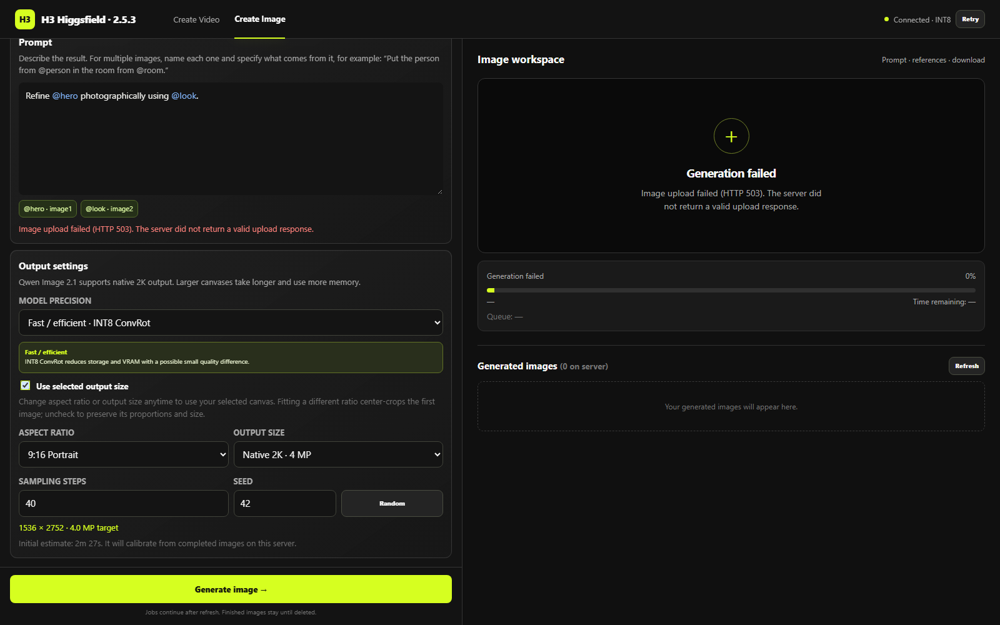

# إصلاح مساحة الصور — 2.5.3

## السبب والإصلاح

- فشل الرفع اتكرر من متصفح الرابط العام: multipart بيرجع HTTP403 وصفحة رفض من بوابة Cloudflare قبل الوصول للخادم. نفس الصورة عبر ComfyUI المحلي وJupyter proxy المحلي نجحت HTTP200. طلب JSON وصل للخادم؛ بقى الرفع يستخدم JSON base64 مع حد للطلب قبل فك الترميز وحد25 MB للملف وفحص صور PIL نفسه. Multipart القديم يظل مدعومًا للعملاء الآخرين.
- المقاس كان مقفول عمدًا عند وجود صورة أولى وخيار Fit غير مفعّل. الآن الاختيارات متاحة بعد الرفع. نود Qwen الأصلي كان يعيد تحجيم أول صورة والناتج حسب Reference Detail؛ الآن encoder resolution=0 والمراجع الإضافية وحدها تتحجم بنود ComfyUI الأصلي. اختيار التفاصيل للمراجع الإضافية؛ الصورة الأولى تتبع مساحة الناتج. تغيير المقاس أو النسبة يفعّل **Use selected output size**. إلغاء الخيار يرجع لمقاس الصورة الأولى؛ كل حالة تنعكس في سطر الأبعاد والجراف. النسبة المختلفة تقص الصورة الأولى من المنتصف، وليست outpainting.
- فشل الرفع لا يمسح المدخلات. الرسالة تفرق بين HTTP غير سليم، الاتصال، القراءة والمهلة. الإلغاء ينهي القراءة أو الرفع وينظف المستمعين.

## الريفريش

الصور محفوظة كملفات داخل IndexedDB، والإعدادات والبرومبت وأسماء المراجع في مسودة التاب. لكل تاب مسودته؛ الحفظ الموجود يستمر دون وضع base64 في sessionStorage. عرض صورة الريفرنس يوضح حالة الحفظ. Clear this tab’s setup يمسح مسودة التاب وحدها.

## التحقق

-359 اختبار Python و152 اختبار JavaScript ناجحين.
- اختبار متصفح مستقل: رفع بايتات الصورة الأصلية كاملة بصيغة JSON، مقاس بعد الرفع يصل إلى ImageScale، رفع مرفوض يترك المدخلات، Refresh يعيد الصورة واسمها والبرومبت والإعدادات، وتاب جديد مستقل.
- اختبار tab-persistence الكامل للفيديو والصور ناجح.
- اختبار backend يستدعي دالة upload_ref الفعلية، ويثبت حفظ الصور الصحيحة بنفس البايتات ورفض الصور المزوّرة والامتداد غير المدعوم دون ترك ملفات، مع بقاء multipart.
- هذه الاختبارات لا تثبت جودة Qwen البصرية لكل prompt أو precision. نتائج الفحص الحي تسجل على السيرفر منفصلة.

## الترقية والرجوع

اللانشر يحمل الموديول الجديد ويحفظ snapshot من الواجهة القديمة، ويتعرف على ملفات2.5.2 الرسمية. شغّل التحديث قبل الرندر، ثم افتح صفحة image.html بعد التحديث. المشاريع والنتائج لا تتحذف. للرجوع اتبع [دليل اللانشر](LAUNCHER.md) واستعد snapshot بعد خلو الطابور؛ ترجع معه الواجهة والنقل القديمان.
