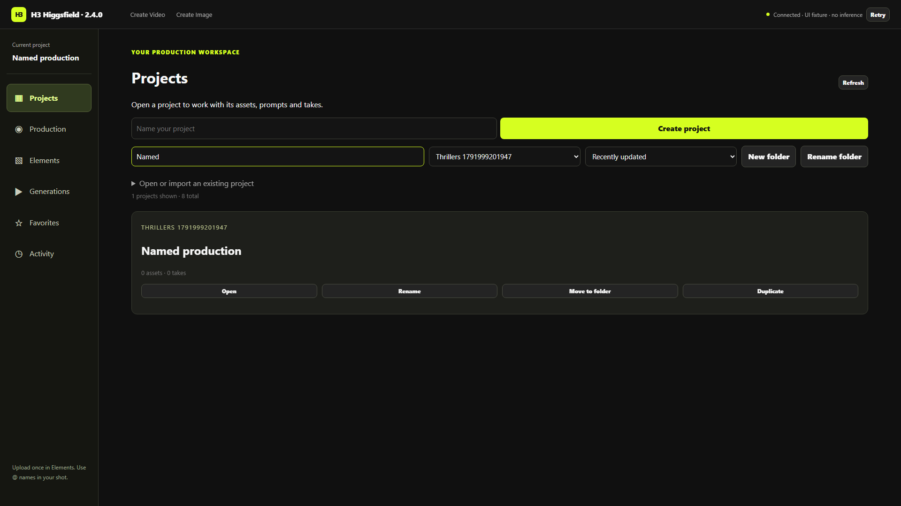
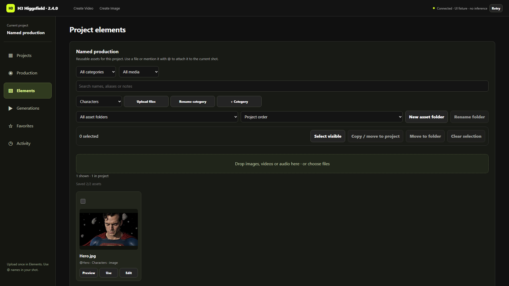
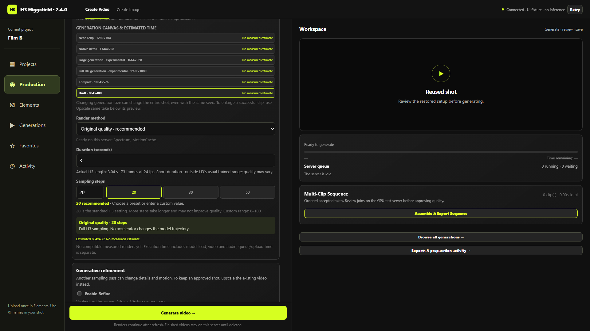

# إدارة المشاريع وReuse — 2.4.0

الشغل ده على الريبو فقط. مفيش اتصال بسيرفر المستخدم أو تشغيل ريندر GPU جديد في الإصدار ده.

## الاستخدام

- من Projects تقدر تسمي مشروع جديد، تغيّر اسمه، تبحث وترتب، تعمل فولدر وتسميه، وتنقل مشروع موجود من Unfiled لفولدر. المشروع الجديد يتضاف للفولدر المختار. من داخل Production فيه Rename project واضح.
- من Elements ارفع صور/فيديو/صوت مرة واحدة، وسمّي كل مادة. الفئات Characters / Locations / Props / Style / Audio / Storyboards / Custom بتحدد دور المادة. فولدرات المواد مستقلة عن الدور؛ نقل Character لفولدر Scene 1 ما يغيّرش هويته أو alias.
- حدّد مادة أو أكتر، أو Select visible، ثم Copy / move to project. النسخ يحافظ على المصدر؛ النقل يتمنع لو المادة مستخدمة في مسودة أو لقطة محفوظة، بما فيها مشاريع clips القديمة. استخدم Copy في الحالة دي.
- كل فيديو له Reuse واضح. بيعرض بياناته المتاحة، وبعد اختيار المشروع بيرجعك لـProduction بالبرومبت، المراجع بالترتيب والـaliases، إعدادات الموديل والسامبلينج والسيد، LoRAs، guides، ControlNet وcontinuation اللي اتحفظوا فعلاً. مش بيبدأ إنتاج تلقائي ومش بيعدل اللقطة الأصلية.
- بعض الفيديوهات القديمة فيها إعدادات جزئية بس. لو البيانات مش متسجلة أصلاً، Reuse بيقول كده. لو فيه ملفات أو لورا أو سياق تكملة ناقصين، التحذير بيستمر بعد الحفظ وإعادة الفتح وGenerate بيتوقف. رجّع الاعتماد الناقص وجرّب Reuse تاني، أو استخدم Confirm edited setup بعد ما تراجع المدخلات؛ الاختيار الأخير بيؤكد إن دي نسخة معدّلة مش استرجاع كامل.
- من Options تقدر تنسخ/تنقل Take لمشروع تاني بعد فتح المشروع المالك. المراجع المطلوبة وأسلاف التكملة بيتنقلوا معاه. نقل لقطة لها descendants خارج التحديد أو موجودة في الـaccepted sequence يتمنع، والنسخ يفضل متاح.
- Export بينزّل ZIP باسم المشروع، وفيه بياناته وكل المواد المسجلة، حتى المواد غير المستخدمة.

## تخزين مرتبط وقابل للاسترجاع

لكل مشروع فولدر فعلي بمعرّفه الثابت تحت `lab_storage/projects/<project-id>` فيه manifest. فولدرات الواجهة تنظيم منطقي؛ الوسائط محفوظة في مخزن مشترك حسب المحتوى ومربوطة بمعرّفات وملكية المشاريع. تغيير الاسم أو نقل مادة ما يعملش نسخ ضخمة للملفات أو يكسر المسارات. الـZIP هو النسخة المحمولة اللي تجمع المواد مع المشروع.

النقل بيستخدم مراجعة إصدار المشروعين وسجل durable للمعاملة. عند انقطاع الكتابة، إعادة التشغيل تستكمل النقل المسجّل؛ إعادة الطلب بنفس request ID ما تكررش العملية. الاسترجاع من jobs بيتجاهل takes المنقولة عشان ما يرجعهاش للمصدر. العمليات بتتقفل أثناء شغل المشروع الحالي أو jobs نشطة للمشاريع المعنية. ده حماية لتعديلات أجهزة متصلة بنفس السيرفر، مش نظام حسابات وصلاحيات لمستخدمين مختلفين.

## 10 أنماط واجهة اتراجعت

| النمط | تطبيقه هنا | المرجع الأصلي |
|---|---|---|
| مشروع يجمع جلسات ومواد | Projects منفصل عن Production وElements؛ معرّف المشروع ثابت | [Runway Projects](https://help.runwayml.com/hc/en-us/articles/52913050653203-Introduction-to-Projects) |
| أسماء وفولدرات واضحة | تسمية من الداخل والخارج، فولدرات للمشاريع والمواد وUnfiled للقديم | [Runway organization](https://help.runwayml.com/hc/en-us/articles/23998498329107-How-to-organize-assets) |
| Copy وMove اختياران مختلفان | فحص الاعتماد قبل النقل، نسخ آمن لو المصدر مستخدم | [Frame.io moving media](https://help.frame.io/en/articles/9101065-moving-media-within-your-account) |
| بحث بنطاق واضح | بحث المشروع/المادة داخل مساحة العمل والفولدر | [Frame.io search](https://help.frame.io/en/articles/9101079-enhanced-search-with-ai-search) |
| تنظيم مجلدات مستقل عن نوع المحتوى | فولدر Scene مستقل عن Character أو Storyboard | [Frame.io folders](https://help.frame.io/en/articles/9101044-creating-folders-and-restricted-folders) |
| أدوات تحديد جماعي | Select visible، عدد المختار، نقل/نسخ وتفريغ التحديد | [Frame.io project layout](https://help.frame.io/en/articles/9101037-project-layout-overview) |
| فلترة بدون تغيير المصدر | الفولدر والنوع والفئة Favorites/Generations لا يغيّروا هوية المادة | [Frame.io collections](https://help.frame.io/en/articles/9101042-collections-overview) |
| بيانات تعرّف المادة | الاسم، alias الثابت، الدور، ملاحظات؛ استخدام مباشر في البرومبت | [Runway tags](https://help.runwayml.com/hc/en-us/articles/37508953406355-Filtering-assets-with-Tags) |
| فصل المكتبة عن الإنتاج والمعاينة | صفحة Elements مستقلة، أفعال واضحة لكل فيديو | [Frame.io panels](https://help.frame.io/en/articles/9101032-panel-overview) |
| تقليل وقت إيجاد وإعادة استخدام اللقطة | بحث/ترتيب cached وReuse يرجع مسودة مستقلة موثقة المصدر | [Frame.io asset findability](https://blog.frame.io/2024/04/30/frame-io-v4-beta-feature-easy-asset-findability-workspaces/) |

البحث ده لا يعني نسخ كل وظائف المواقع: بحث AI، مشاركة بصلاحيات، collections محفوظة وتعليقات مراجعة جماعية مش اتضافوا. الأولوية كانت ربط رحلة إنتاج المشروع بالمكتبة والإعدادات والملفات فعليًا.

## مصفوفة التوافق

| المصدر/العملية | السلوك وحدود الإثبات |
|---|---|
| Take محفوظ بمسودة كاملة | استرجاع fields الحالية؛ الموديل/LoRAs لازم يكونوا متاحين، وقيود الجراف الأصلية تفضل سارية |
| Durable job فيه project snapshot | استرجاع المسودة المسجلة |
| Legacy metadata | استرجاع الحقول المسجلة فقط؛ advanced inputs غير المسجلة تتحوّل لمتطلبات ناقصة |
| فيديو بلا setup | مشاهدة/تنزيل/upscale متاحين؛ Reuse لا يخمن إعدادات إنتاج |
| Generated continuation | يتطلب ملفات السياق `.json` و`.safetensors`؛ لو اتشالوا يظهر نقص |
| Copy مواد/Take | نفس stable IDs، ربط الملكية بالهدف، حفظ المصدر وأسلاف اللقطة |
| Move | متاح للمواد غير المرتبطة بلقطات محتفظ بها، وtakes خارج accepted sequence بدون descendants متروكة |
| Original / Singularity / Hybrid / ControlNet | Reuse يحتفظ بالاختيارات المسجلة؛ ده مش إثبات GPU جديد لتوافق أو جودة كل موديل |

## الاختبار والتحديث والرجوع

اختبار Playwright استخدم API مشاريع/مواد حقيقية محلية، ومقطع CPU اصطناعي؛ لقطة إعدادات fixture لها 73 frame لا تمثل ريندر H3 جديد. Generate الفعلي في الواجهة اتعمله capture قبل دخول أي GPU queue. اتثبت النقل والنسخ، الهوية، الاسم والفولدر والبحث، uint64 seed، البرومبت والـshift، حفظ/reload، بقاء الأصل، حظر لورا ناقصة بعد Save/reload، قفل تغيير السيرفر أثناء النقل، وإلغاء naming فارغ وعدم overflow في عرض 390px.

346 Python tests و148 JavaScript tests نجحوا قبل تجميع الإصدار. [صور ونتيجة اختبار الواجهة](organization/verification.json). لا يوجد إثبات إن كل برومبت أو تركيبة موديلات هتطلع بلا أخطاء؛ GPU والجودة على السيرفر غير مختبرين في التحديث ده. [حدود الموديلات السابقة](COMPATIBILITY_MATRIX_AR.md).

اللانشر بيجيب main الرسمي بالسياسة الحالية قبل خدمات الإنتاج، ويتحقق من عدم وجود عمليات نشطة ويحافظ على تعديلاتك المحلية. الملفات الجديدة ضمن runtime manifest، وبصمات 2.3.2 الرسمية مضافة للترقية الآمنة. اعمل backup لبيانات `lab_storage` قبل تحديث مهم. لو محتاج ترجع كود الإصدار السابق اختار tag `v2.3.2` مع `--no-update`، أو استخدم rollback المسجل للانشر. فولدرات وتنقلات المشاريع إضافة للـmanifest؛ الرجوع للكود لا يعكس نقل مواد اتعمل بالفعل. استرجاع backup البيانات هو اللي يعكسه.

