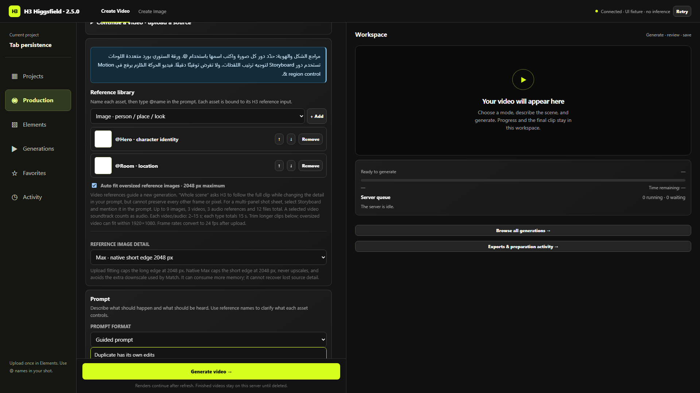

# Refresh يحتفظ بشغل كل تبويب — 2.5.0

كل تبويب ليه نسخة عمل مستقلة من الصفحة. البرومبت والإعدادات والريفيرنسات وأسماؤها وأدوارها وترتيبها، صور البداية والنهاية، الـguides ومدخلات التحكم وإعدادات الصوت والـLoRAs تتحفظ محليًا. بعد Refresh نفس التبويب بيرجع نسخته، حتى لو تبويب تاني فاتح نفس المشروع وبيعدل حاجة مختلفة. صفحة Production والخيارات الموسّعة ذات المعرّف بترجع كمان.

في Generate Image، البرومبت وإعدادات الدقة والريفيرنسات محفوظة لكل تبويب برضه. اختيار BF16 محفوظ، ولو الموديل المطلوب بقى غير متاح، الواجهة توضّح المشكلة بدل ما تبدّله تلقائيًا لـINT8.

لو طلبت Refresh فور آخر تعديل وأثناء كتابة ملف جديد، الصفحة تبدأ الحفظ فورًا والمتصفح ينبه لو الكتابة لم تكتمل. استنى حالة الحفظ قبل المغادرة.

داخل صفحة الفيديو فيه حالة واضحة للحفظ وزر **Clear this tab’s setup**. وفي صفحة الصور فيه نفس خيار المسح. المسح يخص مدخلات التبويب الحالي، ولا يحذف مواد المشروع المحفوظة على السيرفر أو الفيديوهات الناتجة أو مدخلات تبويب تاني.

## الفرق بين نسخة العمل والمشروع المحفوظ

الحفظ التلقائي يحتفظ بالشغل داخل التبويب. زر Save يحفظ إعداد المشروع ومواده على السيرفر للمشاركة والاسترجاع من جهاز آخر. تعديلات تبويب على نسخة العمل مش بتستبدل نسخة تبويب تاني؛ حفظ المشروع المشترك على السيرفر ما زال يستخدم فحص revisions لمنع الكتابة فوق تعديل أحدث بالخطأ.

Refresh في نفس التبويب يرجّع نسخة العمل وهوية طلب الرندر. فتح رابط Studio العادي في صفحة جديدة يبدأ بإعداد فارغ وهوية مستقلة، حتى لو المتصفح نسخ sessionStorage من تبويب آخر؛ كل صفحة تقدر تضيف طلبها المستقل للطابور. آخر مشروع قديم في localStorage لا يُفتح تلقائيًا. روابط المشروع وReuse والطلب المحدد تظل تفتح العمل المطلوب صراحةً.

أيقونة H3 أعلى اليسار تعمل Refresh للتبويب الحالي في صفحتي الفيديو والصور. تنتظر حفظ الملفات محليًا قبل إعادة التحميل، وتتوقف برسالة واضحة لو الحفظ فشل. إغلاق التبويب أو مسح بيانات المتصفح أو تغيير دومين الرابط ممكن ينهي نسخة العمل المحلية؛ لذلك Save المشروع هو الحفظ الدائم.

## التخزين والتعافي

بيانات الإعداد صغيرة داخل sessionStorage الخاص بالتبويب. الملفات داخل IndexedDB كـBlobs فعلية؛ مفيش Base64 في localStorage، ولا نسخ متكررة من نفس الملف أثناء كتابة البرومبت. الملفات ثابتة، والتبويبات المنسوخة تقدر تقرأ الملف نفسه بدون الكتابة فوق بعض.

التبويبات المفتوحة بتجدد مدة استخدام ملفاتها. الملفات غير المستخدمة لمدة 7 أيام قابلة للتنظيف عند إضافة مدخلات جديدة. سقف مخزن ملفات المسودات 1GB، والمتصفح ممكن يفرض سقفًا أقل. لو التخزين امتلأ، الحالة توضح إن الحفظ لم يكتمل وتطلب حفظ المشروع على السيرفر؛ لا تدّعي نجاحًا. المسح لا يحذف ملفًا فورًا قد يحتاجه تبويب آخر؛ التنظيف يعتمد على مدة آخر استخدام.

لو ملف ناقص أو حصل فشل مؤقت أثناء الاسترجاع، المسودة القديمة لا تُستبدل تلقائيًا بإعداد السيرفر. Refresh يعيد محاولة الاسترجاع، أو المستخدم يختار المسح صراحة. توليد الفيديو محجوب وقت فشل استرجاع نسخته حتى يُحل أو تُمسح صراحة. فتح مشروع سليم بعده يظل ممكنًا، والنتيجة المتأخرة لمشروع سابق لا تغيّر المشروع الجديد. الصور تعرض خيارًا صريحًا للمتابعة بدون الريفيرنسات المحفوظة عند تعذر التخزين.

## التحقق

اختبارات المتصفح استخدمت API المشاريع الحقيقي محليًا مع التقاط طلبات الرندر دون إرسال أي عمل GPU. نجحت الحالات التالية:

- صور غير محفوظة يدويًا ترجع بعد Refresh بأسمائها وأدوارها وإعداداتها.
- تبويبان لنفس المشروع يحتفظان ببرومبتين وإعدادين مختلفين.
- نسخ sessionStorage وفتح رابط Studio العادي يبدأ بمدخلات فارغة وهوية رندر جديدة، دون تبني الطلب الجاري في التبويب الأصلي.
- مسح تبويب ثم Refresh لا يرجع المواد الممسوحة، ولا يمسح تبويبًا آخر.
- صفحة الصور تحفظ الريفيرنسات واختيار BF16 وتفصل التبويبات.
- مدخلات فيديو بلا مشروع مفتوح محفوظة محليًا؛ Generate ينشئ مساحة مستقلة تلقائيًا عند الحاجة.
- تجديد مدة استخدام الملف يمنع تنظيفه أثناء استعماله.
- خطأ quota مُحقن لم يمسح metadata القديمة، وغياب ملف لم يستبدل المسودة.
- مشروع سليم يفتح بعد فشل آخر؛ استرجاع متأخر لا يغيّر مساحة أحدث.
- عنوان السيرفر المختار مستقل لكل تبويب. لم تتصل الاختبارات بسيرفر GPU.

[نتائج المتصفح](tabs/tab-browser-verification.json). اختبارات المستودع نجحت: 353 Python و151 JavaScript. [دليل تحسين الصوت](AUDIO_ENHANCEMENT_AR.md) يوضح حدوده، والتحديث والرجوع للإصدار السابق.
